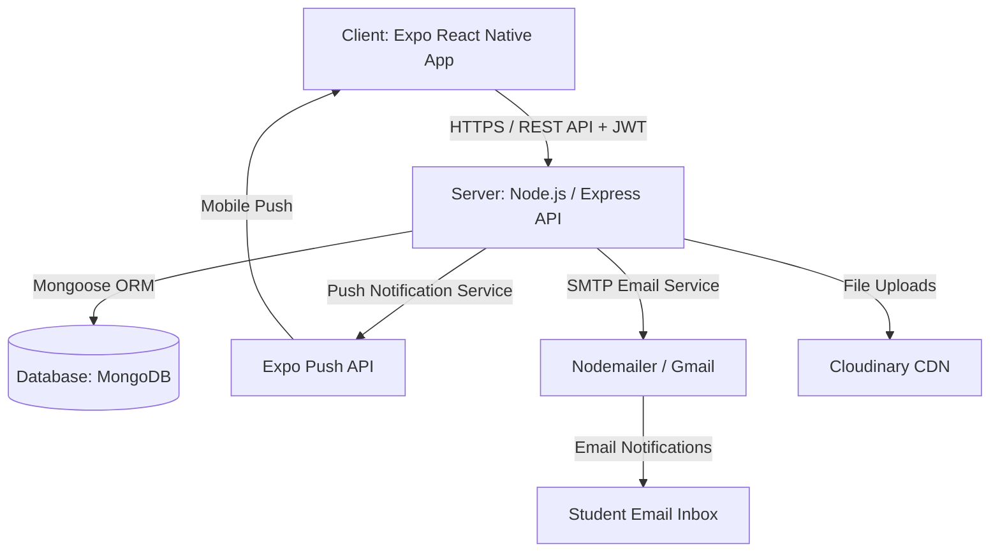

# 🎓 University CSE Department Notice Management System

A full-stack mobile application for the Department of Computer Science & Engineering to manage and distribute academic notices from teachers to students.

---

## 📁 Project Structure

```
university-notice-app/
├── .gitignore                     # Git rules to ignore files (node_modules, .env, etc.)
├── README.md                      # Project overview & setup documentation
├── instruction.txt                # Developer notes & project guidelines
│
├── client/                        # 📱 Frontend Mobile App (Expo / React Native)
│   ├── app/                       # Expo Router file-based navigation & screens
│   │   ├── (auth)/                # Authentication screens (Login, Signup)
│   │   ├── (student)/             # Student dashboard & notice viewing screens
│   │   ├── (teacher)/             # Teacher/Admin dashboard & notice creation screens
│   │   ├── _layout.tsx            # Root layout & navigation providers
│   │   └── index.tsx              # App initial entry point screen
│   ├── components/                # 🧩 Reusable UI Components
│   │   ├── AudiencePicker.tsx     # Selector component to target specific departments/batches
│   │   ├── NoticeCard.tsx         # Card component to render notice details
│   │   ├── CommentItem.tsx        # Component for rendering individual notice comments
│   │   ├── ReadStatusList.tsx     # Component displaying student read receipt statuses
│   │   └── ui/                    # Base UI elements (buttons, text inputs, etc.)
│   ├── constants/                 # API endpoints, theme colors, & app constants
│   ├── hooks/                     # Custom React Hooks
│   ├── services/                  # API client functions for communicating with backend
│   ├── store/                     # State management setup
│   ├── types/                     # TypeScript type definitions & interfaces
│   ├── app.json                   # Expo configuration file
│   ├── tsconfig.json              # TypeScript compiler settings
│   └── package.json               # Frontend dependencies & npm scripts
│
└── server/                        # ⚙️ Backend REST API (Node.js, Express & MongoDB)
    ├── index.js                   # Main backend server entry point
    ├── seed.js                    # Database seeder script for initial sample data
    ├── .env.example               # Template file for environment variables
    ├── package.json               # Backend dependencies & npm scripts
    └── src/                       # Server source code
        ├── config/                # Database connection (MongoDB) configuration
        ├── controllers/           # 🧠 Request handlers & core business logic
        │   ├── authController.js       # Authentication & authorization logic
        │   ├── noticeController.js     # CRUD operations for notices
        │   ├── adminController.js      # Admin management & system operations
        │   ├── commentController.js    # Logic for notice comments
        │   └── studentController.js    # Student profile & user management
        ├── middleware/            # JWT authentication & request validation middleware
        ├── models/                # 🗄️ MongoDB Mongoose Data Schemas
        │   ├── User.js                 # User schema (Student/Teacher/Admin)
        │   ├── Notice.js               # Notice schema
        │   ├── Comment.js              # Comment schema
        │   └── StudentGroup.js         # Department, batch, & section grouping schema
        ├── routes/                # 🛣️ Express API route definitions
        ├── services/              # 🛠️ Core background services
        │   ├── emailService.js             # Email notification service
        │   ├── pushNotificationService.js  # Mobile push notification service
        │   └── excelService.js             # Excel data import/export service
        └── utils/                 # Utility helper functions
            └── resolveRecipients.js

```
---

## 🏛️ System Architecture

The application adopts a **Decoupled Client-Server Architecture** with a mobile client frontend (React Native / Expo Router) communicating via a secure RESTful API with a Node.js/Express backend connected to a MongoDB database.



```text
                     +----------------------------------+
                     |  Expo React Native Mobile App    |
                     |  (Student / Teacher / Admin UI)  |
                     +-----------------+----------------+
                                       |
                                HTTP / HTTPS (REST API)
                                (JWT Authentication)
                                       |
                                       v
                     +----------------------------------+
                     |       Node.js / Express API      |
                     |           (Backend)              |
                     +----+------------+-----------+----+
                          |            |           |
       +------------------+            |           +------------------+
       |                               |                              |
       v                               v                              v
+---------------+             +-----------------+            +------------------+
| MongoDB Atlas |             | Expo Push API   |            | SMTP Email Server|
| (Database)    |             | (Mobile Push)   |            | (Nodemailer)     |
+---------------+             +-----------------+            +------------------+
```

---

## 🔄 End-to-End System Workflows

### 1️⃣ Authentication & Authorization Workflow
```text
[ User Inputs Credentials ] ➔ [ POST /api/auth/login ] ➔ [ Validate Password (Bcrypt) ]
                                                                   │
                                                                   ▼
[ Navigate to Role Layout ] ⬅️ [ Return User Profile + JWT ] ⬅️ [ Generate JWT Token ]
```
1. **Login:** User logs in using Email/Roll Number and Password.
2. **Validation:** Server verifies hashed password using `bcrypt`.
3. **Token Dispatch:** Issues a short-lived **Access Token (15m)** and a **Refresh Token (7d)**.
4. **Role Redirection:** Client routes the user based on role:
   - Students ➔ `(student)` route layout
   - Teachers & Admins ➔ `(teacher)` route layout

---

### 2️⃣ Targeted Notice Creation & Multi-Channel Delivery
```text
[ Teacher Creates Notice ]
            │
            ▼
[ Select Target Audience ] ➔ (Department / Year / Batch / Roll Range / Custom Group)
            │
            ▼
[ POST /api/notices ] ➔ [ Save to MongoDB (Notice Schema) ]
            │
            ├───────────────────────────────────────────────┐
            ▼                                               ▼
[ resolveRecipients Service ]                   [ Send Push Notifications ]
(Queries target student IDs & tokens)            (via Expo Push Notification API)
            │
            ▼
[ Send Email Alerts ]
(via Nodemailer / emailService.js)
```
1. **Notice Composition:** Teacher inputs title, content, attachments, and selects the audience criteria via `AudiencePicker`.
2. **Audience Resolution (`resolveRecipients.js`):** System calculates matching student IDs.
3. **Storage:** Saves the notice in MongoDB database.
4. **Multicast Notification:**
   - Sends real-time Push Notifications via Expo Push Service.
   - Dispatches Email alerts via Nodemailer for offline/email notification preferences.

---

### 3️⃣ Notice Consumption & Read Receipt Tracking
```text
[ Student Opens App ] ➔ [ GET /api/notices/feed ] ➔ [ Display Targeted Feed ]
                                                            │
                                                            ▼
[ Admin Views Read Stats ] ⬅️ [ Update DB (readBy Array) ] ⬅️ [ Student Taps Notice ]
```
1. **Targeted Feed:** Students view notices matching their year, department, or section.
2. **Read Status Update:** When a student opens a notice detail view, `POST /api/notices/:id/read` marks their ID in the `readBy` array with a timestamp.
3. **Analytics:** Teachers/Admins track real-time read statistics (e.g., *45 out of 60 read*) with breakdown progress bars.

---

### 4️⃣ Bulk User Onboarding Workflow
```text
[ Admin Uploads Excel File ] ➔ [ POST /api/admin/import/students ]
                                            │
                                            ▼
                              [ excelService.js Parses File ]
                                            │
                                            ▼
                              [ Bulk Upsert Users into MongoDB ]
                                            │
                                            ▼
                              [ Email Credentials to Students ]
```
1. Admin uploads an Excel file (`.xlsx`) containing student or teacher records.
2. `excelService.js` parses the file and performs bulk MongoDB upserts.
3. Accounts are generated with temporary passwords and emailed to recipients.

---

## 🏛️ System Architecture

The application adopts a **Decoupled Client-Server Architecture** with a mobile client frontend (React Native / Expo Router) communicating via a secure RESTful API with a Node.js/Express backend connected to a MongoDB database.


```text
                     +----------------------------------+
                     |  Expo React Native Mobile App    |
                     |  (Student / Teacher / Admin UI)  |
                     +-----------------+----------------+
                                       |
                                HTTP / HTTPS (REST API)
                                (JWT Authentication)
                                       |
                                       v
                     +----------------------------------+
                     |       Node.js / Express API      |
                     |           (Backend)              |
                     +----+------------+-----------+----+
                          |            |           |
       +------------------+            |           +------------------+
       |                               |                              |
       v                               v                              v
+---------------+             +-----------------+            +------------------+
| MongoDB Atlas |             | Expo Push API   |            | SMTP Email Server|
| (Database)    |             | (Mobile Push)   |            | (Nodemailer)     |
+---------------+             +-----------------+            +------------------+
```

---

## 🔄 End-to-End System Workflows

### 1️⃣ Authentication & Authorization Workflow
```text
[ User Inputs Credentials ] ➔ [ POST /api/auth/login ] ➔ [ Validate Password (Bcrypt) ]
                                                                   │
                                                                   ▼
[ Navigate to Role Layout ] ⬅️ [ Return User Profile + JWT ] ⬅️ [ Generate JWT Token ]
```
1. **Login:** User logs in using Email/Roll Number and Password.
2. **Validation:** Server verifies hashed password using `bcrypt`.
3. **Token Dispatch:** Issues a short-lived **Access Token (15m)** and a **Refresh Token (7d)**.
4. **Role Redirection:** Client routes the user based on role:
   - Students ➔ `(student)` route layout
   - Teachers & Admins ➔ `(teacher)` route layout

---

### 2️⃣ Targeted Notice Creation & Multi-Channel Delivery
```text
[ Teacher Creates Notice ]
            │
            ▼
[ Select Target Audience ] ➔ (Department / Year / Batch / Roll Range / Custom Group)
            │
            ▼
[ POST /api/notices ] ➔ [ Save to MongoDB (Notice Schema) ]
            │
            ├───────────────────────────────────────────────┐
            ▼                                               ▼
[ resolveRecipients Service ]                   [ Send Push Notifications ]
(Queries target student IDs & tokens)            (via Expo Push Notification API)
            │
            ▼
[ Send Email Alerts ]
(via Nodemailer / emailService.js)
```
1. **Notice Composition:** Teacher inputs title, content, attachments, and selects the audience criteria via `AudiencePicker`.
2. **Audience Resolution (`resolveRecipients.js`):** System calculates matching student IDs.
3. **Storage:** Saves the notice in MongoDB database.
4. **Multicast Notification:**
   - Sends real-time Push Notifications via Expo Push Service.
   - Dispatches Email alerts via Nodemailer for offline/email notification preferences.

---

### 3️⃣ Notice Consumption & Read Receipt Tracking
```text
[ Student Opens App ] ➔ [ GET /api/notices/feed ] ➔ [ Display Targeted Feed ]
                                                            │
                                                            ▼
[ Admin Views Read Stats ] ⬅️ [ Update DB (readBy Array) ] ⬅️ [ Student Taps Notice ]
```
1. **Targeted Feed:** Students view notices matching their year, department, or section.
2. **Read Status Update:** When a student opens a notice detail view, `POST /api/notices/:id/read` marks their ID in the `readBy` array with a timestamp.
3. **Analytics:** Teachers/Admins track real-time read statistics (e.g., *45 out of 60 read*) with breakdown progress bars.

---

### 4️⃣ Bulk User Onboarding Workflow
```text
[ Admin Uploads Excel File ] ➔ [ POST /api/admin/import/students ]
                                            │
                                            ▼
                              [ excelService.js Parses File ]
                                            │
                                            ▼
                              [ Bulk Upsert Users into MongoDB ]
                                            │
                                            ▼
                              [ Email Credentials to Students ]
```
1. Admin uploads an Excel file (`.xlsx`) containing student or teacher records.
2. `excelService.js` parses the file and performs bulk MongoDB upserts.
3. Accounts are generated with temporary passwords and emailed to recipients.

---

## 🖥️ Server

### Tech Stack
| Layer | Technology |
|---|---|
| Runtime | Node.js (Express.js) |
| Database | MongoDB (Mongoose) |
| Auth | JWT (Access + Refresh tokens) |
| File Upload | Multer + Cloudinary (PDFs) |
| Email | Nodemailer + Gmail SMTP |
| Push Notifications | Expo Push Notification Service |
| Excel Import | `xlsx` |

### Setup

```bash
cd server
npm install

# Configure environment
cp .env.example .env
# Edit .env with your MongoDB URI, JWT secrets, Cloudinary keys, Gmail credentials
```

### Environment Variables (`.env`)

```env
PORT=5000
MONGODB_URI=mongodb://localhost:27017/cse_notice_db

JWT_SECRET=your_super_secret_jwt_key_here
JWT_EXPIRES_IN=15m
JWT_REFRESH_SECRET=your_super_secret_refresh_key_here
JWT_REFRESH_EXPIRES_IN=7d

CLOUDINARY_CLOUD_NAME=your_cloud_name
CLOUDINARY_API_KEY=your_api_key
CLOUDINARY_API_SECRET=your_api_secret

EMAIL_FROM_NAME=CSE Notice System
EMAIL_FROM_ADDRESS=your_gmail@gmail.com
GMAIL_USER=your_gmail@gmail.com
GMAIL_APP_PASSWORD=your_gmail_app_password
```

> **Gmail App Password**: Go to Google Account → Security → 2-Step Verification → App Passwords → Generate a password for "Mail"

### Start Server

```bash
npm run dev   # Development with nodemon
npm start     # Production
```

### API Endpoints

| Method | Route | Access | Description |
|---|---|---|---|
| POST | `/api/auth/login` | Public | Login with email/password |
| POST | `/api/auth/refresh` | Public | Refresh access token |
| GET | `/api/auth/me` | Auth | Get current user |
| PUT | `/api/auth/me` | Auth | Update profile / push token |
| PUT | `/api/auth/change-password` | Auth | Change password |
| POST | `/api/auth/forgot-password` | Public | Send reset email |
| POST | `/api/auth/reset-password` | Public | Reset with token |
| POST | `/api/auth/logout` | Auth | Invalidate refresh token |
| **Notices** | | | |
| GET | `/api/notices` | Teacher | My notices (paginated) |
| POST | `/api/notices` | Teacher | Create notice (TEXT/PDF) |
| GET | `/api/notices/feed` | Student | Student notice feed |
| GET | `/api/notices/:id` | Both | Notice detail |
| PUT | `/api/notices/:id` | Teacher | Edit own notice |
| DELETE | `/api/notices/:id` | Teacher | Soft-delete notice |
| POST | `/api/notices/:id/read` | Student | Mark as read |
| GET | `/api/notices/:id/read-status` | Teacher | Read/unread breakdown |
| **Comments** | | | |
| GET | `/api/notices/:id/comments` | Both | Get comments |
| POST | `/api/notices/:id/comments` | Student | Add comment |
| DELETE | `/api/notices/:id/comments/:cid` | Both | Delete comment |
| **Students** | | | |
| GET | `/api/students/search` | Teacher | Search students |
| POST | `/api/students/resolve-audience` | Teacher | Preview recipient count |
| **Admin** | | | |
| POST | `/api/admin/import/students` | Admin | Bulk import via Excel |
| POST | `/api/admin/import/teachers` | Admin | Bulk import via Excel |
| GET | `/api/admin/users` | Admin | List all users |
| GET | `/api/admin/groups` | Teacher/Admin | List groups |
| POST | `/api/admin/groups` | Teacher | Create group |
| PUT | `/api/admin/groups/:id` | Teacher | Update group |
| DELETE | `/api/admin/groups/:id` | Teacher | Delete group |

### Admin: Excel Import Format

**Students Excel** columns (case-insensitive):
`Name, Email, Roll, RegistrationNo, Year, Semester, Batch, Gender`

**Teachers Excel** columns:
`Name, Email, Designation, Gender`

---

## 📱 Client

### Tech Stack

| Layer | Technology |
|---|---|
| Framework | Expo SDK 51 (React Native) |
| Navigation | Expo Router (file-based) |
| State | Zustand |
| HTTP | Axios (with token refresh interceptor) |
| Storage | Expo SecureStore |
| Push Notifications | Expo Notifications |
| File Picker | Expo Document Picker |
| Animations | React Native Animated |

### Setup

```bash
cd client
npm install
```

> Update `constants/api.ts` with your server IP:
> - Android Emulator: `http://10.0.2.2:5000/api`
> - iOS Simulator: `http://localhost:5000/api`
> - Physical Device: `http://YOUR_LOCAL_IP:5000/api`

### Run

```bash
npx expo start
# Press `a` for Android, `i` for iOS
```

---

## 🧩 Target Audience Types

| Type | Description |
|---|---|
| `SELECTED_STUDENTS` | Manually selected students from interactive year table |
| `CUSTOM_GROUP` | A teacher-defined named group |
| `SPECIFIC_ROLL` | One or more specific roll numbers (API legacy) |
| `ROLL_RANGE` | All students between roll A and roll B (API legacy) |
| `YEAR_ALL` | All students of a specific year (1–5) (API legacy) |
| `YEAR_FEMALE` | Female students of a specific year (API legacy) |
| `ALL_CSE` | Every active CSE student (API legacy) |
| `ALL_CSE_FEMALE` | All female CSE students (API legacy) |

---

## 👤 User Roles

| Role | Can Do |
|---|---|
| **Teacher** | Create/Edit/Delete notices, view read status, manage custom groups |
| **Student** | View assigned notices, mark as read, comment/reply |
| **Admin** | Import users via Excel (Admin module — future) |

---

## 🔐 Auth Flow

1. Admin imports users via Excel → system creates accounts with temporary passwords
2. System emails credentials to each user
3. On first login, user is forced to change their password
4. Access token (15m) + Refresh token (7d) issued
5. Client auto-refreshes tokens via Axios interceptor

---

## ✨ Features

- 🌙 **Dark theme** throughout — premium dark UI
- 📊 **Read status** with progress bar and per-student tracking
- 📄 **PDF notices** uploaded to Cloudinary, linked in-app
- 🔔 **Push notifications** (Expo) + **Email fallback** for students without the app
- 👥 **Custom groups** — teachers can define reusable audience groups
- 🔍 **Student search** with name, roll, year, batch filters
- 📱 **Infinite scroll + pull-to-refresh** on all lists
- 💬 **Flat comments** (one-level replies) on notices
- 🔒 **JWT refresh** — seamless token renewal, no re-login
